# 考试报名系统

> 🎓 **计算机毕业设计 · 考试报名系统**
>
> 本仓库只放**项目介绍 + 运行截图**（截图是站点带水印的原图，存在仓库 `images/` 里）。
>
> 👉 **完整可运行源码 / 数据库脚本 / 部署文档：[点我获取](https://geekcode.top/archives/%E8%80%83%E8%AF%95%E6%8A%A5%E5%90%8D%E7%B3%BB%E7%BB%9F?utm_source=github)**
>
> 💬 咨询微信：**ir9372**　|　🌐 更多项目：[极客代码 geekcode.top](https://geekcode.top/?utm_source=github)
>
> 📌 项目详情页：<https://geekcode.top/archives/%E8%80%83%E8%AF%95%E6%8A%A5%E5%90%8D%E7%B3%BB%E7%BB%9F?utm_source=github>

<table><td width="230" align="center"> <b>扫码加微信 ir9372</b></td><td valign="middle">📦 源码 = 项目介绍 + 全部运行截图 + 数据库 + 部署文档 👉 点上方任意截图，直接跳到 <b>极客代码 geekcode.top</b> 详情页</td></table>

---

<h1>考试报名系统</h1>
<h2>项目概述</h2>

本考试报名系统旨在构建一个集考试信息管理、在线报名、成绩发布及师生互动于一体的综合性服务平台。项目采用前后端分离架构，基于 Spring Boot 后端框架与 Vue 前端技术栈开发，结合 MyBatis-Plus 进行数据持久层管理，并使用 Apache Shiro 实现安全权限控制。系统核心功能涵盖前台用户的考试资讯浏览、在线报名、准考证查看、成绩查询以及论坛交流；后台管理端则支持管理员对教师、学生、考试信息、新闻资讯、论坛内容等数据的全面维护与管理。该系统适用于高校或培训机构进行标准化考试的组织与管理，能够有效提升考务工作效率，优化用户交互体验，实现考试全流程的数字化闭环管理。

<h2>技术架构</h2>
<h3>1. 整体架构设计</h3>

本项目采用典型的 B/S（Browser/Server）架构模式，具体分为表现层、业务逻辑层和数据访问层。

<ul>
<li><strong>表现层</strong>：由 Vue.js 构建的前端应用组成，分为面向普通用户的前台界面和面向管理员的后台管理界面。通过 Axios 发起 HTTP 请求与后端进行数据交互。</li>
<li><strong>业务逻辑层</strong>：基于 Spring Boot 框架搭建，负责处理具体的业务逻辑，如报名流程控制、成绩计算逻辑、权限校验等。控制器（Controller）包括 <code>AboutusController</code>, <code>CommonController</code>, <code>ConfigController</code>, <code>FileController</code>, <code>ForumController</code>, <code>JiaoshiController</code>, <code>KaoshibaomingController</code>, <code>KaoshichengjiController</code>, <code>KaoshixinxiController</code>, <code>NewsController</code>, <code>SystemintroController</code>, <code>UsersController</code> 等，分别对应不同的业务模块。</li>
<li><strong>数据访问层</strong>：使用 MyBatis-Plus 作为 ORM 框架，简化了 CRUD 操作代码编写，底层依赖 <code>mysql-connector-java</code> 连接 MySQL 数据库。</li>
</ul>
<h3>2. 核心技术选型理由</h3>
<ul>
<li><strong>Spring Boot</strong>: 提供快速开发能力，自动配置特性减少了繁琐的 XML 配置，内置 Tomcat 服务器便于部署。</li>
<li><strong>MyBatis-Plus</strong>: 在 MyBatis 基础上增强，提供了通用的 Mapper 和 Service，极大提高了开发效率，同时保留了 SQL 的灵活性以应对复杂查询。</li>
<li><strong>Apache Shiro</strong>: 轻量级的 Java 安全框架，用于实现认证（Authentication）、授权（Authorization）和会话管理，确保系统不同角色（如管理员、教师、学生）的数据隔离和操作安全。</li>
<li><strong>Vue + Element UI (推测)</strong>: 虽然上下文未明确提及 UI 库，但鉴于“vue-integrated”类型及常见的后台路由结构，前端通常配合组件化库实现响应式界面，保证用户体验的一致性。</li>
</ul>
<h3>3. 数据库设计要点</h3>

数据库主要存储以下核心实体关系：

<ul>
<li><strong>用户体系</strong>：包含管理员、教师、学生三类基本身份信息。</li>
<li><strong>考试业务</strong>：涉及考试信息表、报名表、准考证表、考试成绩表。</li>
<li><strong>内容管理</strong>：包含新闻资讯表、论坛帖子表、关于我们/系统简介等静态内容表。</li>
<li><strong>系统配置</strong>：包含配置文件表，用于管理系统参数。</li>
</ul>
<h2>功能模块</h2>

根据提供的后台路由、控制器列表及截图功能列表，系统将功能划分为前台用户端和后台管理端两部分。

<h3>1. 前台用户端功能</h3>

前台主要面向学生、教师及访客，提供信息查询与自助服务功能。

<table>
<thead>
<tr>
<th align="left">模块名称</th>
<th align="left">功能描述</th>
</tr>
</thead>
<tbody><tr>
<td align="left"><strong>首页</strong></td>
<td align="left">展示系统概览、最新公告、热门考试信息及推荐新闻。</td>
</tr>
<tr>
<td align="left"><strong>考试信息</strong></td>
<td align="left">浏览各类考试的详细信息，包括考试时间、地点、科目等。</td>
</tr>
<tr>
<td align="left"><strong>新闻资讯</strong></td>
<td align="left">查看发布的考试通知、政策变动及相关教育新闻。</td>
</tr>
<tr>
<td align="left"><strong>论坛</strong></td>
<td align="left">参与讨论区，发布帖子或回复他人评论，促进师生交流。</td>
</tr>
<tr>
<td align="left"><strong>个人中心</strong></td>
<td align="left">用户登录后的专属区域，包含以下子功能：1. <strong>我的报名</strong>：查看已提交的考试报名记录。2. <strong>我的成绩</strong>：查询个人考试成绩详情。3. <strong>我的准考证</strong>：下载或查看电子准考证。4. <strong>个人信息修改</strong>：更新个人资料。</td>
</tr>
<tr>
<td align="left"><strong>其他视图</strong></td>
<td align="left">支持查看教师列表、公告列表等公开信息。</td>
</tr>
</tbody></table>
<h3>2. 后台管理端功能</h3>

后台主要面向系统管理员，提供全量的数据管理与配置功能。

<table>
<thead>
<tr>
<th align="left">模块路径</th>
<th align="left">功能描述</th>
</tr>
</thead>
<tbody><tr>
<td align="left"><code>/news</code></td>
<td align="left"><strong>新闻资讯管理</strong>：增删改查新闻文章，支持富文本编辑。</td>
</tr>
<tr>
<td align="left"><code>/kaoshibaoming</code></td>
<td align="left"><strong>考试报名管理</strong>：审核学生的报名申请，管理报名状态。</td>
</tr>
<tr>
<td align="left"><code>/aboutus</code></td>
<td align="left"><strong>关于我们管理</strong>：维护“关于我们”页面的文本与图片内容。</td>
</tr>
<tr>
<td align="left"><code>/systemintro</code></td>
<td align="left"><strong>系统简介管理</strong>：编辑系统介绍文案，用于前台展示。</td>
</tr>
<tr>
<td align="left"><code>/xuesheng</code></td>
<td align="left"><strong>学生管理</strong>：录入、修改、删除学生账号信息，重置密码等。</td>
</tr>
<tr>
<td align="left"><code>/jiaoshi</code></td>
<td align="left"><strong>教师管理</strong>：维护教师基本信息、联系方式及账号状态。</td>
</tr>
<tr>
<td align="left"><code>/zhunkaozheng</code></td>
<td align="left"><strong>准考证管理</strong>：生成、分发及管理考生的准考证信息。</td>
</tr>
<tr>
<td align="left"><code>/kaoshichengji</code></td>
<td align="left"><strong>考试成绩管理</strong>：录入、批量导入或修改考生考试成绩。</td>
</tr>
<tr>
<td align="left"><code>/forum</code></td>
<td align="left"><strong>论坛管理</strong>：审核论坛帖子，删除违规内容，管理评论区。</td>
</tr>
<tr>
<td align="left"><code>/kaoshixinxi</code></td>
<td align="left"><strong>考试信息管理</strong>：创建新的考试项目，设置报名时间、考试时间等规则。</td>
</tr>
<tr>
<td align="left"><code>/config</code></td>
<td align="left"><strong>系统配置</strong>：设置网站标题、Logo、轮播图等全局参数。</td>
</tr>
<tr>
<td align="left"><code>/login</code></td>
<td align="left"><strong>后台登录</strong>：管理员身份验证入口。</td>
</tr>
</tbody></table>
<h2>用户角色与权限</h2>

系统基于 Apache Shiro 实现细粒度的权限控制，主要存在以下三种角色：

<h3>1. 管理员 (Admin)</h3>

拥有系统的最高权限，可访问所有后台管理模块。

<ul>
<li><strong>可访问功能</strong>：</li>
<li>全部后台路由：<code>/news</code>, <code>/kaoshibaoming</code>, <code>/aboutus</code>, <code>/systemintro</code>, <code>/xuesheng</code>, <code>/jiaoshi</code>, <code>/zhunkaozheng</code>, <code>/kaoshichengji</code>, <code>/forum</code>, <code>/kaoshixinxi</code>, <code>/config</code>。</li>
<li>负责用户账户（学生、教师）的生命周期管理。</li>
<li>负责核心业务数据（考试、报名、成绩、准考证）的维护。</li>
<li>负责内容运营（新闻、论坛、页面介绍）的管理。</li>
</ul>
<h3>2. 教师 (Teacher)</h3>

主要作为被管理对象出现在系统中，但在特定场景下可能具备部分查看权限（依据常规系统设计推断，具体需看代码中是否赋予教师独立登录入口，当前上下文显示有 <code>JiaoshiController</code> 且后台有 <code>/jiaoshi</code> 路由，暗示教师数据由管理员维护，教师本人可能仅在前台注册或登录）。

<ul>
<li><strong>若教师可登录前台</strong>：</li>
<li>查看考试信息、新闻资讯。</li>
<li>参与论坛讨论。</li>
<li>查看与自己相关的教学或监考安排（若有相关字段关联）。</li>
<li><strong>注意</strong>：根据现有信息，教师主要作为数据实体存在于后台管理中，其具体前台权限取决于 <code>UsersController</code> 中的角色判断逻辑。</li>
</ul>
<h3>3. 学生 (Student)</h3>

系统的主要服务对象，通过前台进行自助操作。

<ul>
<li><strong>可访问功能（前台）</strong>：</li>
<li><strong>浏览</strong>：首页、考试信息、新闻资讯、论坛。</li>
<li><strong>个人中心操作</strong>：</li>
<li><strong>考试报名</strong>：选择考试科目并提交报名申请。</li>
<li><strong>成绩查询</strong>：查看自己的考试成绩。</li>
<li><strong>准考证打印</strong>：获取并打印准考证。</li>
<li><strong>论坛互动</strong>：发帖、回帖。</li>
<li><strong>限制</strong>：无法访问任何后台管理路由，无法修改他人数据，只能操作属于自己账号范围内的信息。</li>
</ul>
<h2>项目特色与创新点</h2>
<ol>
<li>
<strong>全流程数字化考务管理</strong>：
   项目覆盖了从“信息发布 -&gt; 在线报名 -&gt; 准考证生成 -&gt; 考试实施 -&gt; 成绩录入 -&gt; 成绩查询”的完整生命周期。相比传统线下纸质流程，极大地降低了人工统计错误率，提升了考务组织效率。

</li>
<li>
<strong>多角色协同机制</strong>：
   通过 Shiro 框架实现了清晰的角色边界。管理员专注于数据治理与内容运营，学生专注于自助服务，教师作为资源方参与体系。这种分工明确了各方的职责，避免了权限混乱。

</li>
<li>
<strong>社区化互动支持</strong>：
   集成论坛模块（<code>ForumController</code>），打破了传统考试系统单向通知的模式。允许考生在备考期间进行交流答疑，增强了用户粘性和平台活跃度，形成了良好的学习氛围。

</li>
<li>
<strong>灵活的配置化管理</strong>：
   引入 <code>/config</code> 路由及 <code>ConfigController</code>，使得网站的基础信息（如名称、Logo、简介）无需修改代码即可动态调整，提高了系统的可维护性和扩展性。

</li>
<li>
<strong>前后端分离的高效架构</strong>：
   采用 Vue 与 Spring Boot 分离部署，前端渲染速度快，用户体验流畅；后端接口标准化，便于后续移动端适配或第三方系统集成。

</li>
</ol>
<h2>部署环境</h2>

为确保系统正常运行，建议准备以下软件环境：

<table>
<thead>
<tr>
<th align="left">类别</th>
<th align="left">软件名称</th>
<th align="left">版本要求</th>
<th align="left">说明</th>
</tr>
</thead>
<tbody><tr>
<td align="left"><strong>操作系统</strong></td>
<td align="left">Windows / Linux / macOS</td>
<td align="left">-</td>
<td align="left">推荐使用 Linux (CentOS/Ubuntu) 进行生产部署</td>
</tr>
<tr>
<td align="left"><strong>Java 环境</strong></td>
<td align="left">JDK</td>
<td align="left">1.8 或以上</td>
<td align="left">Spring Boot 运行必需</td>
</tr>
<tr>
<td align="left"><strong>数据库</strong></td>
<td align="left">MySQL</td>
<td align="left">5.7 或 8.0</td>
<td align="left">存储业务数据，需配置字符集为 utf8mb4</td>
</tr>
<tr>
<td align="left"><strong>Web 容器</strong></td>
<td align="left">Tomcat</td>
<td align="left">内置于 Spring Boot</td>
<td align="left">若打成 WAR 包部署则需外部 Tomcat，JAR 包启动则无需</td>
</tr>
<tr>
<td align="left"><strong>前端构建</strong></td>
<td align="left">Node.js</td>
<td align="left">12.x - 16.x</td>
<td align="left">用于编译 Vue 前端代码</td>
</tr>
<tr>
<td align="left"><strong>包管理器</strong></td>
<td align="left">npm / yarn</td>
<td align="left">最新版</td>
<td align="left">安装前端依赖</td>
</tr>
<tr>
<td align="left"><strong>缓存/中间件</strong></td>
<td align="left">无强制要求</td>
<td align="left">-</td>
<td align="left">根据源码依赖，暂未发现 Redis 或 MQ 强依赖，如需高性能可额外配置</td>
</tr>
</tbody></table>

<strong>部署步骤简述：</strong>

<ol>
<li>初始化 MySQL 数据库，导入项目提供的 SQL 脚本。</li>
<li>修改后端 <code>application.yml</code> 或 <code>application.properties</code> 中的数据库连接地址、用户名和密码。</li>
<li>使用 Maven 打包后端项目 (<code>mvn clean package</code>)，生成 JAR 文件并运行。</li>
<li>进入前端目录，执行 <code>npm install</code> 安装依赖，然后执行 <code>npm run build</code> 生成静态资源。</li>
<li>将生成的静态资源部署到 Nginx 或直接放在 Spring Boot 项目的 static 目录下（视具体集成方式而定）。</li>
</ol>
<h2>五、技术特性</h2>
<ul>
<li>前后端集成部署，前端资源打包至后端 static 目录</li>
<li>使用 MyBatis-Plus 简化数据访问层开发</li>
<li>集成 Shiro 权限框架实现角色权限控制</li>
</ul>
<h2>六、功能模块截图</h2>
<h3>前台用户端</h3>
<h4>前台-教师列表</h4>

<a href="https://geekcode.top/archives/%E8%80%83%E8%AF%95%E6%8A%A5%E5%90%8D%E7%B3%BB%E7%BB%9F?utm_source=github" title="查看完整源码">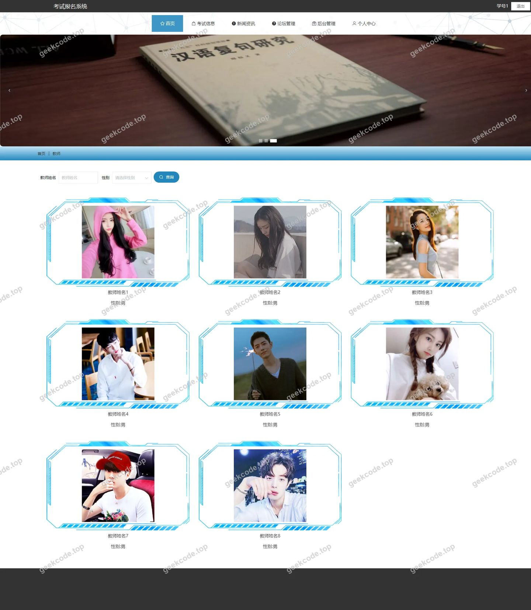</a>

<h4>前台-考试报名列表</h4>

<a href="https://geekcode.top/archives/%E8%80%83%E8%AF%95%E6%8A%A5%E5%90%8D%E7%B3%BB%E7%BB%9F?utm_source=github" title="查看完整源码">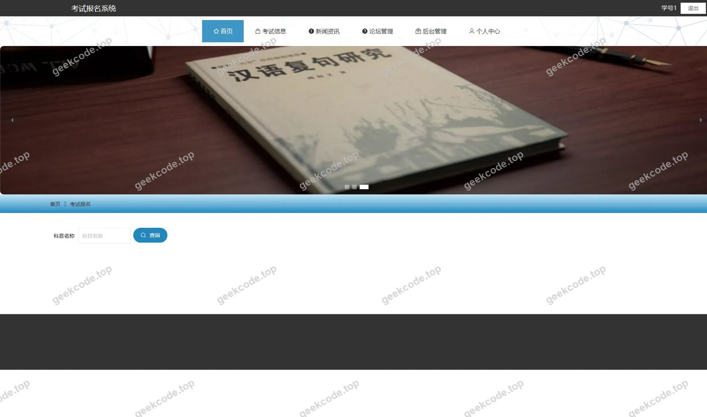</a>

<h4>前台-考试成绩列表</h4>

<a href="https://geekcode.top/archives/%E8%80%83%E8%AF%95%E6%8A%A5%E5%90%8D%E7%B3%BB%E7%BB%9F?utm_source=github" title="查看完整源码">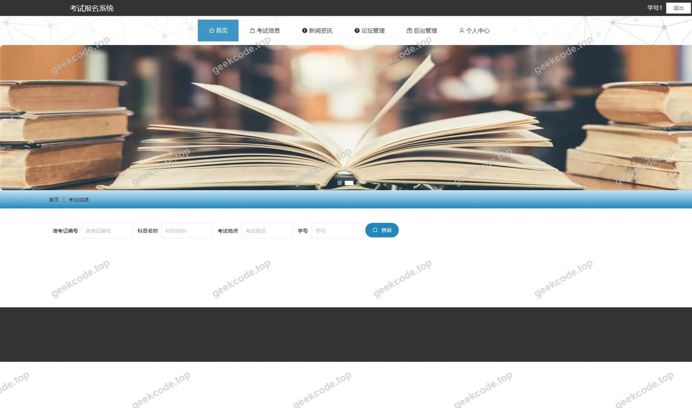</a>

<h4>前台-考试信息列表</h4>

<a href="https://geekcode.top/archives/%E8%80%83%E8%AF%95%E6%8A%A5%E5%90%8D%E7%B3%BB%E7%BB%9F?utm_source=github" title="查看完整源码">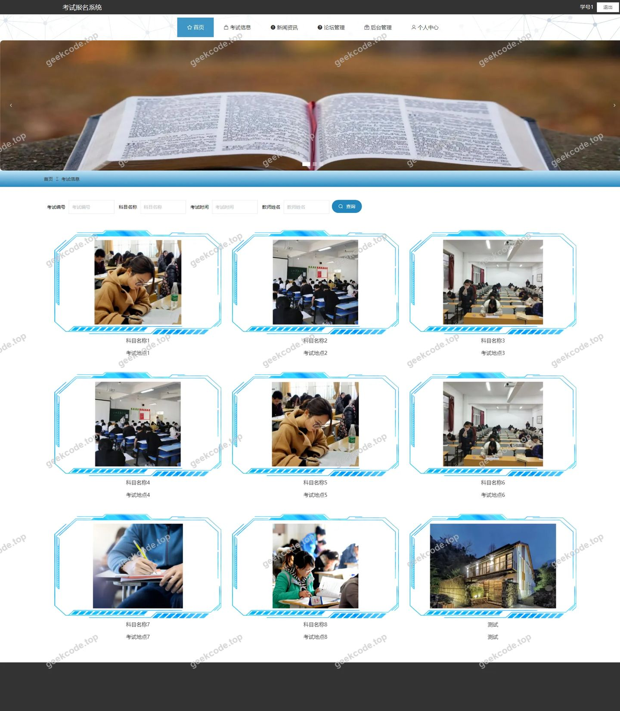</a>

<h4>前台-准考证列表</h4>

<a href="https://geekcode.top/archives/%E8%80%83%E8%AF%95%E6%8A%A5%E5%90%8D%E7%B3%BB%E7%BB%9F?utm_source=github" title="查看完整源码">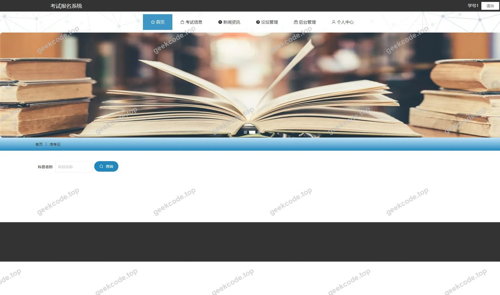</a>

<h4>前台-个人中心</h4>

<a href="https://geekcode.top/archives/%E8%80%83%E8%AF%95%E6%8A%A5%E5%90%8D%E7%B3%BB%E7%BB%9F?utm_source=github" title="查看完整源码">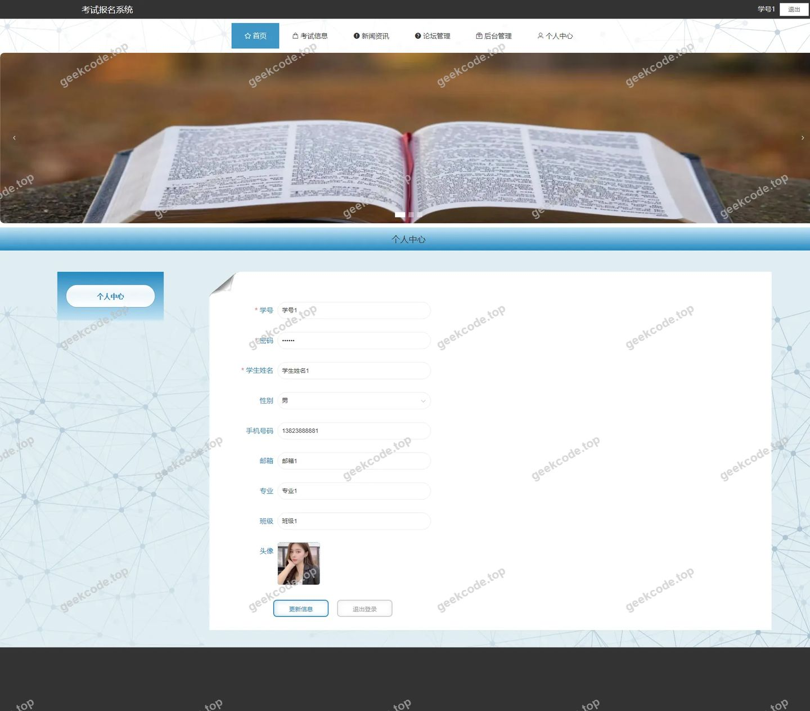</a>

<h4>前台-公告列表</h4>

<a href="https://geekcode.top/archives/%E8%80%83%E8%AF%95%E6%8A%A5%E5%90%8D%E7%B3%BB%E7%BB%9F?utm_source=github" title="查看完整源码">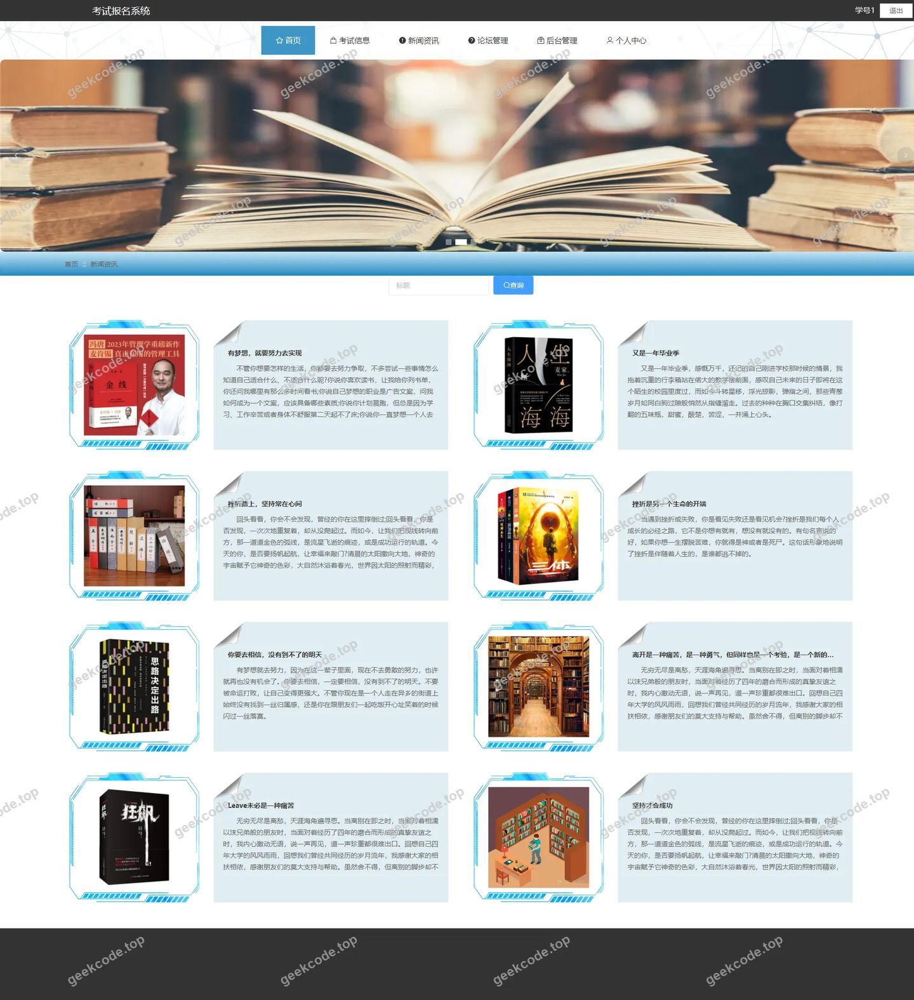</a>

<h3>后台管理端</h3>
<h4>后台-登录页</h4>

<a href="https://geekcode.top/archives/%E8%80%83%E8%AF%95%E6%8A%A5%E5%90%8D%E7%B3%BB%E7%BB%9F?utm_source=github" title="查看完整源码">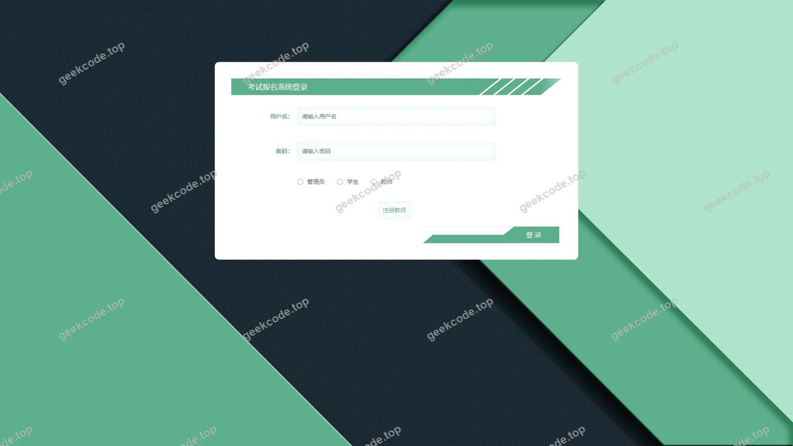</a>

<h4>后台-系统简介</h4>

<h4>后台-关于我们</h4>

<h4>后台-教师</h4>

<h4>后台-考试报名</h4>

<a href="https://geekcode.top/archives/%E8%80%83%E8%AF%95%E6%8A%A5%E5%90%8D%E7%B3%BB%E7%BB%9F?utm_source=github" title="查看完整源码">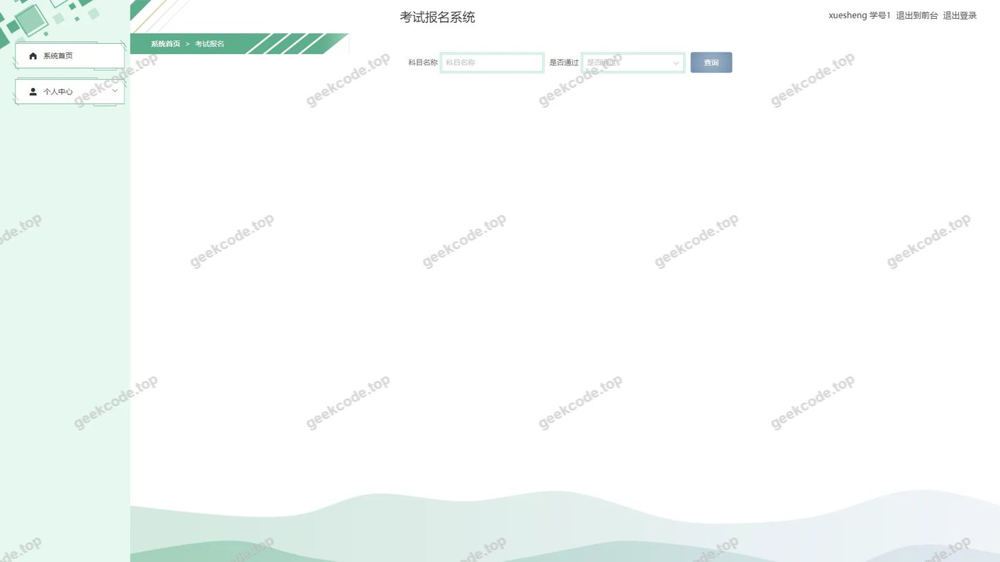</a>

<h4>后台首页</h4>

<a href="https://geekcode.top/archives/%E8%80%83%E8%AF%95%E6%8A%A5%E5%90%8D%E7%B3%BB%E7%BB%9F?utm_source=github" title="查看完整源码">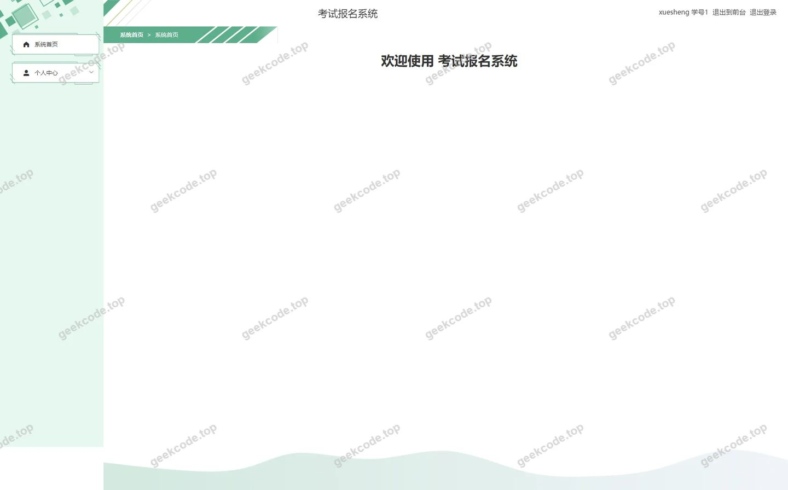</a>

<h4>后台-新闻资讯</h4>

<a href="https://geekcode.top/archives/%E8%80%83%E8%AF%95%E6%8A%A5%E5%90%8D%E7%B3%BB%E7%BB%9F?utm_source=github" title="查看完整源码">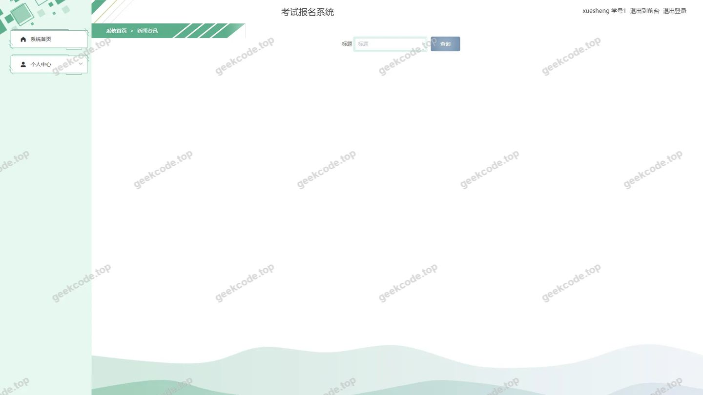</a>

<h4>后台-学生</h4>

<a href="https://geekcode.top/archives/%E8%80%83%E8%AF%95%E6%8A%A5%E5%90%8D%E7%B3%BB%E7%BB%9F?utm_source=github" title="查看完整源码">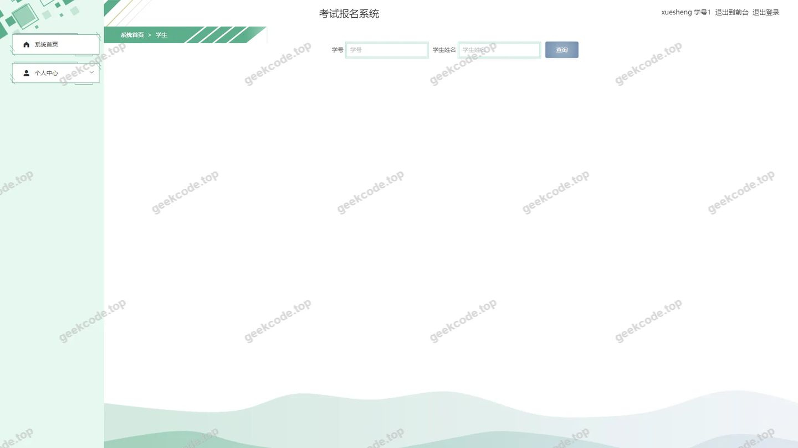</a>

---

## 获取完整源码

| 项目 | 说明 |
| --- | --- |
| 项目名 | 考试报名系统 |
| 运行截图 | 本文 15 张（站点带水印原图，仓库 `images/` 目录） |
| 完整源码 | [https://geekcode.top/archives/%E8%80%83%E8%AF%95%E6%8A%A5%E5%90%8D%E7%B3%BB%E7%BB%9F?utm_source=github](https://geekcode.top/archives/%E8%80%83%E8%AF%95%E6%8A%A5%E5%90%8D%E7%B3%BB%E7%BB%9F?utm_source=github) |
| 咨询微信 | **ir9372**（备注：jingpin-yuanma） |
| 更多项目 | [极客代码 geekcode.top](https://geekcode.top/?utm_source=github) |

> 需要源码、部署、改配置、跑不起来等问题，加微信 ir9372 沟通，说明项目名即可。
